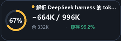

# Codex Context Meter

[](https://github.com/RSmfOffice/codex-context-meter/actions/workflows/windows-ci.yml)
[](LICENSE)

一个跟随 Codex 桌面窗口显示**当前单个会话**上下文状态的轻量悬浮组件。



## 功能

- 显示当前上下文占用圆环、已用 token 和剩余 token。
- 显示当前会话累计缓存命中率。
- 检测图片 data URI 载荷；provider 返回 413 时单独显示请求体超限，不误报为上下文接近上限。
- 支持跨多个 Codex 对话连续转接，生成结构化快照、完整历史链和全部交接索引。
- 自动跟随 Codex 当前选中的聊天，不跨会话累加。
- 悬浮窗归属 Codex，不全局置顶，也不会遮挡其他应用。
- 支持拖动、位置记忆、自动跟随和右键手动锁定会话。
- Codex 最小化或退出时隐藏，恢复后重新出现。
- 支持登录后自动启动、后台守护和 MCP 状态/启停工具。
- 右键可直接打开 Codex 团队任务看板，并在需要时自动拉起本地看板服务。
- 基于本会话 compaction 比例和 413 失败边界显示简洁的提前预警。

## 系统要求

- Windows 10 或 Windows 11。
- Codex 桌面版；当前会话识别依赖其 UI Automation 树。
- Python 3.11+，并安装 Pillow。
- 使用插件安装方式时，还需要 Codex CLI、Node.js 18+ 和 Windows PowerShell 5.1+。

## 手动运行

```powershell
git clone https://github.com/RSmfOffice/codex-context-meter.git
cd codex-context-meter
python -m pip install -r requirements.txt
pythonw.exe .\codex_context_meter.pyw
```

也可以双击 `start-codex-context-meter.cmd`。

## 插件安装

在仓库根目录运行 Windows PowerShell：

```powershell
powershell.exe -NoProfile -ExecutionPolicy Bypass `
  -File .\codex-context-meter-plugin\scripts\install.ps1 `
  -TeamBoardRoot ..\codex-team-board
```

安装器会：

1. 将根目录 Python 源码同步到插件运行目录。
2. 安装个人插件到 `%USERPROFILE%\plugins\codex-context-meter`。
3. 注册登录计划任务 `Codex Context Meter`。
4. 配置自动启动和 supervisor 健康恢复。
5. 写入团队看板根目录和 URL，供右键菜单自动启动看板。

首次安装后重启一次 Codex，使插件和 MCP 工具进入当前进程。

若尚未安装团队看板，可先克隆并安装
[`RSmfOffice/codex-team-board`](https://github.com/RSmfOffice/codex-team-board)，
或独立安装插件：

```powershell
powershell.exe -NoProfile -ExecutionPolicy Bypass `
  -File .\codex-context-meter-plugin\scripts\install.ps1 `
  -NoTeamBoardIntegration
```

也可以通过仓库 marketplace 安装：

```powershell
codex plugin marketplace add RSmfOffice/codex-context-meter --ref v0.1.5
codex plugin add codex-context-meter@codex-tools
```

## 使用

| 操作 | 效果 |
| --- | --- |
| 左键拖动 | 在 Codex 客户区内移动并记忆位置 |
| 左键单击 | 解除手动锁定并恢复自动跟随当前会话 |
| 右键单击 | 查看精确数值、打开团队看板、选择会话、恢复自动跟随或退出 |

更完整的指标口径、刷新机制和限制见 [CODEX_CONTEXT_METER.md](CODEX_CONTEXT_METER.md)。

## 团队看板联动

看板默认地址为 `http://127.0.0.1:8765`。插件会依次从配置、用户环境变量、
`%USERPROFILE%\plugins\codex-team-board`、`%USERPROFILE%\CodexTools`、同级克隆
目录和 `%LOCALAPPDATA%\CodexTeamBoard` 自动发现面板源码。

推荐由面板安装器统一配置：

```powershell
Set-Location ..\codex-team-board
powershell.exe -NoProfile -ExecutionPolicy Bypass `
  -File .\scripts\install.ps1 `
  -ContextMeterRoot ..\codex-context-meter
```

也可手工设置：

```powershell
[Environment]::SetEnvironmentVariable(
  "CODEX_TEAM_BOARD_ROOT",
  "C:\Tools\codex-team-board",
  "User"
)
[Environment]::SetEnvironmentVariable(
  "CODEX_TEAM_DASHBOARD_URL",
  "http://127.0.0.1:8765",
  "User"
)
```

右键“打开 Codex 团队看板”会先检查 `/api/health`；未运行时通过发现的
`src/teamctl.py` 启动看板，再打开默认浏览器。

## 计量方式

上下文占用采用“provider 锚点 + 表层增量”：

```text
projected = last_token_usage.input_tokens
          + estimate(response items after the latest usage anchor)
```

`token_count` 提供精确锚点；锚点之后尚未产生新 usage 的内容按固定密度估算，
界面以 `~` 标记。下一次 provider usage 到达后会自动校准。

缓存命中率为：

```text
total_token_usage.cached_input_tokens
/ total_token_usage.input_tokens
```

只使用当前单个 `thread_id` 的累计值。

### 为什么 token 未满仍可能 413？

上下文 token 窗口与 HTTP 请求体大小是两个独立限制。图片较多时，即使 token
占用较低，base64 图片也可能让请求体超过 provider 的传输上限。插件会显示图片
数量、估算请求体大小，并在检测到 `413 Request Entity Too Large` 时给出红色警告。

不同会话的网关或路由限制可能不同。插件优先使用本会话已经成功的最大请求体和
已经失败的最小请求体判断风险；只有缺少本会话证据时，才使用可配置的
32MiB/42MiB 保守预警线。右键菜单可随时生成 Markdown 交接报告。

## 架构

- `codex_context_meter/`：统计、会话识别、Tk 界面和跟随逻辑。
- `codex-context-meter-plugin/`：Codex 个人插件、MCP 服务、安装与守护脚本。
- `window_follower.py`：独立 Win32 跟随子进程，异步移动现有窗口。
- `handoff.py`：结构化交接链、完整历史归档和索引。
- `docs/HANDOFF-FORMAT.md`：agent 自动发现顺序、标准格式和恢复协议。
- 统计和会话解析在后台线程运行；UI 只在内容变化时重绘。

## 连续交接

悬浮窗右键“生成交接报告…”可以让同一任务使用相同的交接链名称。
MCP 工具 `context_meter_handoff` 可提交更完整的摘要、决策、已完成项、
待办、关键文件、验证记录和下一步。

每个交接链包含：

- `latest.json`：最新交接元数据。
- `index.json`：该链全部交接的顺序索引。
- `chain-context.md`：累计全部交接的完整上下文。
- `hf-*.md`：每次交接的结构化当前快照。

新会话必须完整读取 `chain-context.md` 后再继续，不能只读最新一份或用摘要
替代历史，因此多轮转接不会遗漏此前上下文。默认位于
`%LOCALAPPDATA%\CodexContextMeter\handoffs\chains`。

为便于 agent 自动发现：

- 有工作目录时，会在项目根写入托管区块 `HANDOFF.md`，并镜像完整链到
  `.codex/handoffs/codex-context-meter/`。
- 无有效项目目录时，会回退到 `%CODEX_HOME%\handoffs\HANDOFF.md`。
- 项目内入口优先于全局入口；全局入口会记录 `workspacePath`，不与当前工作目录
  匹配时不得自动套用。

完整规范见 [HANDOFF-FORMAT.md](docs/HANDOFF-FORMAT.md)。

## 隐私

- 不读取或保存 API key。
- 只读取本机 Codex 会话 JSONL 中的标题、token usage 和模型可见内容结构。
- 运行状态仅保存在 `%LOCALAPPDATA%\CodexContextMeter`。
- 不上传会话内容、日志或配置。

## 卸载

```powershell
powershell.exe -NoProfile -ExecutionPolicy Bypass `
  -File "$env:USERPROFILE\plugins\codex-context-meter\scripts\uninstall.ps1"
```

## 开发与验证

```powershell
python -m pip install -r requirements.txt
powershell.exe -NoProfile -ExecutionPolicy Bypass -File .\scripts\check.ps1
```

构建发布压缩包：

```powershell
powershell.exe -NoProfile -ExecutionPolicy Bypass -File .\scripts\build-release.ps1
```

## 已知限制

- Codex 大版本升级可能改变 UI Automation 树，需要回归会话标题识别。
- 同名会话只能按最近更新时间选择；可使用右键菜单手动锁定。
- 锚点之后的增量是估算值，CJK、代码和复杂 JSON 可能有偏差。
- provider 的 413 请求体上限不会改变上下文 token 百分比；需要根据图片数量和请求体警告控制附件规模。
- compaction 后可能短暂显示“等待下一次 usage 校准”。
- 当前仅支持 Windows。

## License

[MIT](LICENSE)
